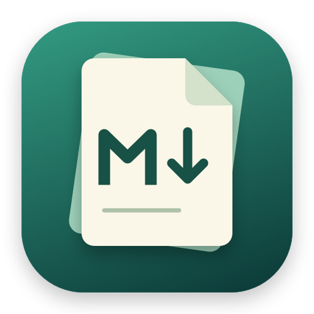
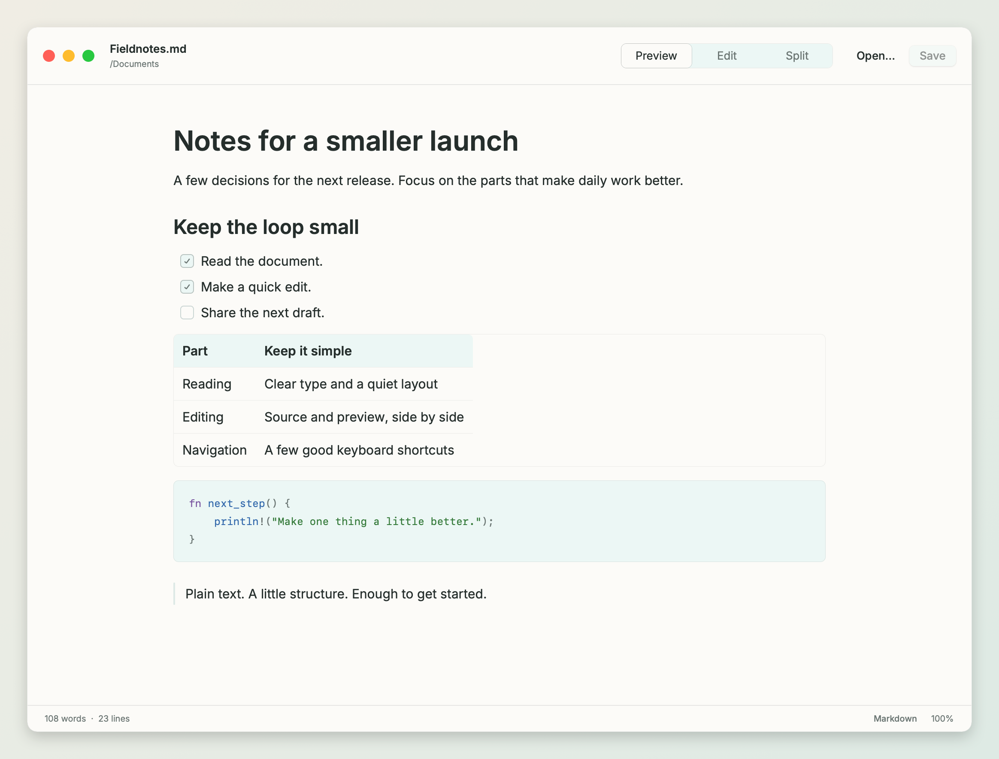
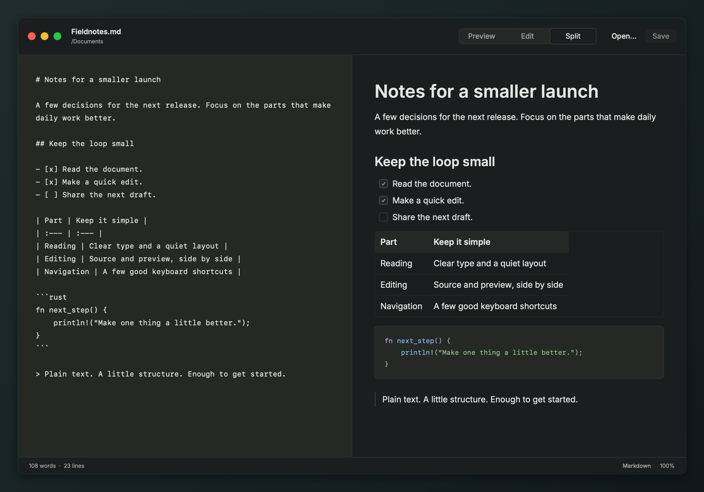

<p align="center">
  
</p>

<h1 align="center">Folio</h1>

<p align="center">
  A native Markdown viewer and light editor for macOS.<br>
  Built with Rust and <a href="https://github.com/anomalyco/rune">Rune</a>. Rendered with Metal.
</p>

<p align="center">
  <a href="#install">Install</a> · <a href="#keyboard">Keyboard</a> · <a href="#development">Development</a>
</p>



## Read and edit

Open a Markdown file, read it, make a quick change. Choose **Preview**, **Edit**, or **Split**—the document stays a plain file on disk.

- **Readable Markdown.** Tables, task lists, syntax-highlighted code, Mermaid diagrams, and local images.
- **Heading outline.** A faint outline in the preview expands on hover. Move over headings to magnify them, then click to jump to a section.
- **One-way split sync.** Source edits and scrolling guide the preview. Scrolling the preview leaves the editor where it is.
- **Keyboard navigation.** Search app commands, fuzzy-find recent files, and preview tabs before switching.
- **Native file handling.** Open from Finder, drop files into the window, or use `md` in Terminal.



## Install

Requires macOS, a current [Rust toolchain](https://rustup.rs/), and Xcode or its command-line tools.

```sh
git clone https://github.com/nickj/folio.git
cd folio
./scripts/install.sh --default
```

This builds for your Mac, installs **`~/bin/apps/Folio.app`** and **`~/bin/md`**, and makes Folio the default for `.md`, `.markdown`, `.mdown`, `.mkd`, and `.mkdn` files. Add `~/bin` to your `PATH` if it isn't already there.

Use `./scripts/install.sh` to install without changing file associations. Local builds are ad-hoc signed, not notarized for distribution.

## Open a document

```sh
md
md README.md
md notes.md "Project plan.md"
```

`md` opens the app; filenames open in tabs. Finder’s **Open With** and drag-and-drop work too.

## Keyboard

| Shortcut | Action |
| :--- | :--- |
| **⌘⇧P** | Command palette |
| **⌘⇧O** | Fuzzy-find recent documents |
| **Ctrl+Tab / Ctrl+Shift+Tab** | Preview recently used tabs, forward / backward |
| ⌘O / ⌘N | Open / New |
| ⌘S / ⌘⇧S | Save / Save As |
| ⌘1 / ⌘2 / ⌘3 | Preview / Edit / Split |
| ⌘F / ⌘G / ⌘⇧G | Find / Next match / Previous match |
| ⌘+ / ⌘− / ⌘0 | Larger text / Smaller text / Actual size |
| ⌘W | Close document |

**Command palette:** file actions, editing and clipboard commands, search, views, appearance, open tabs, and window controls. Type to filter, use ↑/↓ to select, and Return to run.

**Heading outline:** choose **Focus Outline** from the command palette for keyboard navigation. Use ↑/↓ or Home/End to select a heading, Return to jump, and Escape to leave. Long outlines scroll independently of the document.

**Recent documents:** fuzzy matches filenames and paths. An empty query shows the most recently opened files first.

**Tab switcher:** hold Control and press Tab to see a rendered preview. Keep pressing Tab to cycle, add Shift to reverse, and release Control to switch. Escape cancels.

## Files and saves

Save writes to the original file. Unsaved edits are kept as recovery drafts and restored after a restart; **Don’t Save** in the close-document dialog discards that draft.

Saves are atomic, preserve permissions and CRLF/BOM encoding, and follow symlink targets. Folio reloads clean documents when they change on disk and checks for external changes before saving an edited file.

Files must be UTF-8 and at most **8 MB**. Remote images aren't fetched, and arbitrary HTML isn't executed.

<details>
<summary><strong>Local state</strong></summary>

Folio stores its state in `~/Library/Application Support/Folio/`:

- `drafts.json` — recovery drafts for unsaved documents.
- `recents.json` — the last 100 successfully opened or saved files.

**Clear Recent Documents** in the command palette removes the history, not the files. Closing the window keeps the app and its documents available.

</details>

## Development

```sh
cargo test --locked
cargo clippy --all-targets --locked -- -D warnings
cargo fmt --check
./scripts/build.sh
```

The app bundle is written to `dist/Folio.app`. Rune is pinned to a revision, and `Cargo.lock` is committed.

<details>
<summary><strong>Regenerate the screenshots</strong></summary>

```sh
./scripts/screenshots.sh
```

The screenshots use Rune’s headless renderer, bundled demo documents, and its macOS chrome overlay. The script adds a backdrop and excludes the renderer’s diagnostic bounds. Final images live in `docs/images/`; intermediate renders stay in `target/readme/`.

For an unframed render:

```sh
target/release/folio --scene showcase --theme light --snap /tmp/folio.png
```

</details>

## License

[MIT](LICENSE) © Nick Jensen
